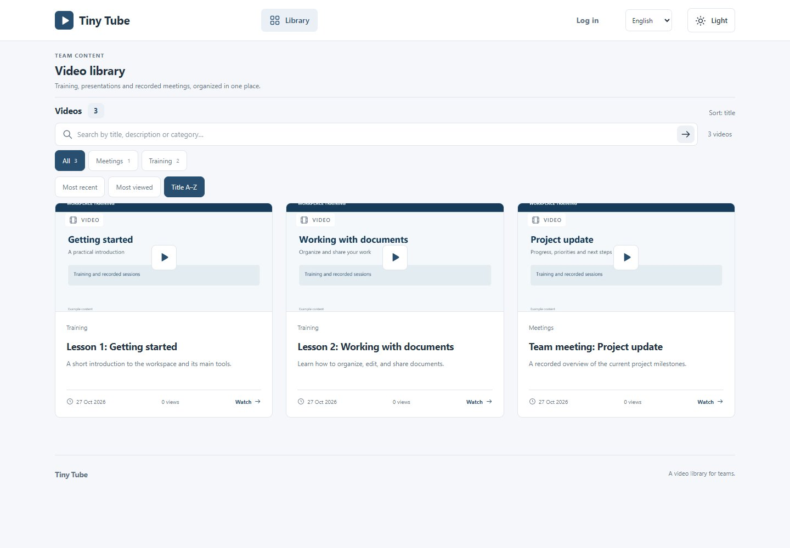
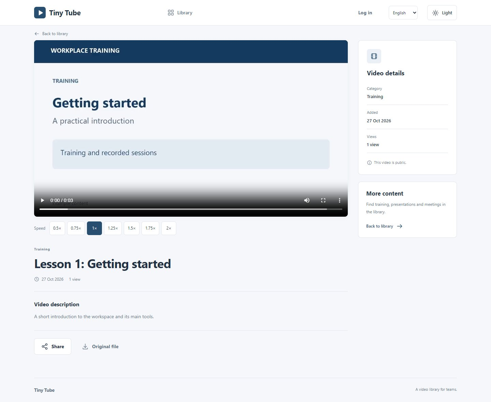
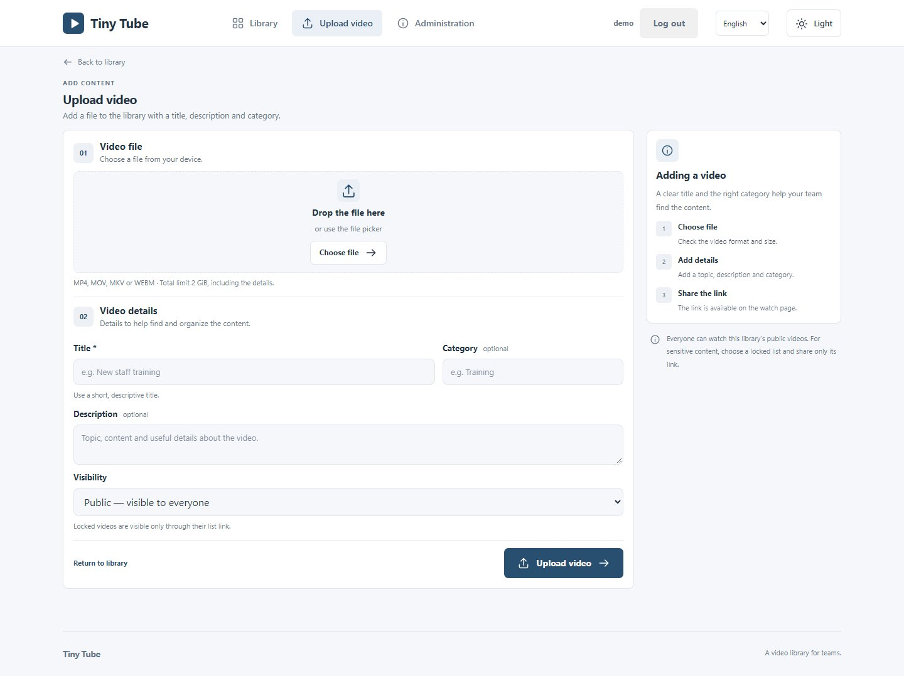

# Tiny Tube

[](https://github.com/spapas/tiny-tube/actions/workflows/ci.yml)

Tiny Tube is a self-contained video-sharing server for training, presentations,
and recorded meetings. It stores media on disk and metadata in SQLite, with
optional FFmpeg conversion to HLS and preview posters. Viewing is public;
uploading and editing require login with an editor or administrator account,
and deleting or managing users requires an administrator. Videos can also be
assigned to locked lists, visible only through a long list link
(`/view_list?key=…`); editors and administrators bypass keys for management.
Users authenticate
with a local password (bcrypt) or against LDAP; roles are assigned locally.
SQLite uses the pure Go
`modernc.org/sqlite` driver, so single-binary builds do not require CGO. Legacy
filesystem JSON metadata remains available with `STORE=fs`.

Upload isolation, request limits, metadata replacement, and bounded conversion
workers are covered by regression tests. See the [review and remaining
limitations](docs/REVIEW.md) when planning an installation.

## Screenshots

The examples below use demonstration content.

**Library:** browse by category, search, and sort videos by date, views, or title.



**Watch:** play a video, adjust playback speed, and share or download the original.



**Upload:** add a video and choose its title, category, description, and visibility.



## Installation

### 1. Download and extract

Download the archive for your system from [GitHub Releases](https://github.com/spapas/tiny-tube/releases):
Windows (`.zip`), Linux, or macOS (`.tar.gz`), choosing `amd64` for Intel/AMD
or `arm64` for ARM, including Apple Silicon. Extract it and open a terminal in
the extracted folder. The binaries are unsigned; Windows or macOS may show a
security prompt.

The release contains the server, the `tiny-tube-cli` administration tool,
configuration examples, documentation, and `VERSION.txt`. Go and a separate
database server are not required: SQLite and the web interface are included.
You need a writable video directory with space for originals and generated media.

To verify the download, compare its hash with the matching filename in the
release's `SHA256SUMS`. For example, for the v1.0.3 amd64 archives:

```powershell
# Windows PowerShell
Get-FileHash .\tiny-tube-v1.0.3-windows-amd64.zip -Algorithm SHA256
```

```sh
# Linux
sha256sum tiny-tube-v1.0.3-linux-amd64.tar.gz
# macOS (use darwin-arm64 for Apple Silicon)
shasum -a 256 tiny-tube-v1.0.3-darwin-amd64.tar.gz
```

Use the filename for the version and platform you downloaded.

### 2. Configure the first administrator

For a **new installation**, copy `.env.example` to `.env` in the extracted folder:

```powershell
# Windows PowerShell
Copy-Item .env.example .env
```

```sh
# Linux / macOS
cp .env.example .env
```

Open `.env` in a text editor and set `ADMIN_PASS` to a strong password. The
default administrator name is `admin`; change `ADMIN_USER` if you prefer.
The password cannot be empty or `changeme`. Keep `.env` private: it may contain
credentials. Do not replace an existing `.env` when upgrading.

### 3. Start the server

From that same extracted folder, run:

```powershell
# Windows PowerShell
.\tiny-tube.exe
```

```sh
# Linux / macOS
./tiny-tube
```

Open <http://localhost:8081> on the same computer. Sign in with the administrator
credentials, then use **Upload video** to add a video or **Administration** to
manage users. Press `Ctrl+C` in the terminal to stop the server.

On the first start with an empty user table, Tiny Tube creates the administrator.
After that, manage users and passwords at `/admin`; changing `ADMIN_USER` or
`ADMIN_PASS` does not change existing accounts. The library starts empty. By
default, videos and the SQLite database are stored in `videos/` under the
working directory.

For HLS conversion and automatically generated posters, install FFmpeg separately
with the `libx264` and AAC encoders, and make it available on `PATH` (or set
`FFMPEG_BIN`). Without FFmpeg, original-file playback remains available when the
browser supports the video's format and codecs.

The default address only accepts local connections. For network access, configure
the address and HTTPS; see [Configuration](#configuration) and the [Nginx example](#optional-nginx-deployment).
Plan backups of the videos and database; Tiny Tube does not create them
automatically. See [Security](docs/SECURITY.md) and [remaining limitations](docs/REVIEW.md).

For a long-running Linux deployment, configure a service with the intended
working directory, absolute `VIDEO_DIR`, and credentials. If conversion is
needed, ensure the service can find FFmpeg. A systemd unit is not included.

For operator role fixes without the web UI, the release's `tiny-tube-cli`
provides `users list` and `users set-role --username U --role admin|editor|viewer`.
Use the same `VIDEO_DIR`, `STORE`, and `DB_PATH` settings as the server. The CLI
refuses to demote the last active administrator.

## Locked lists

Public videos stay visible to everyone. For sensitive material, an
administrator creates any number of locked lists at `/admin/lists` (section
«Κλειδωμένες λίστες»), each with its own long random key. Uploads and edits
offer a visibility picker: public by default, or one locked list per video.
Existing videos stay public unless moved.

- Holders of `/view_list?key=…` see exactly that list; without the key its
  videos are invisible everywhere — library, search, category counts, watch
  page, JSON API, originals, HLS segments and posters all answer 404.
- The first key visit sets an unlock cookie so posters, HLS segments and
  later pages keep working without repeating the key.
- Editors and administrators see every video without a key, so lost links
  never block management.
- A link is a bearer credential: anyone it is forwarded to gains access.
  Share links only over a safe channel. Rotating the key («Αλλαγή κλειδιού»)
  revokes every copy at once, including previously granted cookies.
  Deleting a list is refused while it still holds videos, so videos cannot
  silently become public.
- The Nginx sample proxies every route through Go, so the same checks apply
  behind the proxy.
- Missing/unreadable metadata never authorizes media access. Orphan files without
  metadata return 404; recover their metadata before sharing them.
- Visibility changes are synchronized with media authorization. Failed list-picker
  loads block upload/edit forms. An API edit omitting `access_list` preserves
  visibility; send an explicit empty value to make a video public.
- Copy Link offers a locked-video URL only when its valid list key is present.
  Otherwise the page explains that the original locked-list link is required.

For scripts, pass the key as `?key=…` on `/api/videos`, `/api/video`,
`/watch` and `/videos/…`, or reuse the unlock cookie from a link visit.

## Configuration

The server loads `.env` from its working directory. Explicit environment variables
take precedence, including empty values. Values may be quoted; there is no variable
expansion or inline-comment support. `.env` is ignored by Git.

| Variable | Default | Behavior |
| --- | --- | --- |
| `VIDEO_DIR` | `videos` | Video storage; relative paths use the process working directory. |
| `ADDR` | unset | Full `host:port` bind address, overriding `HOST` and `PORT`. Default effective address is `127.0.0.1:8081`. |
| `HOST` | `127.0.0.1` | Bind host when `ADDR` is unset. Set `0.0.0.0` explicitly for IPv4 network access. |
| `PORT` | `8081` | HTTP port when `ADDR` is unset; `PORT=8080` remains supported. |
| `STORE` | `sqlite` | Metadata backend: `sqlite` or legacy `fs`. Video files remain on disk in both modes. |
| `DB_PATH` | `<VIDEO_DIR>/tiny-tube.db` | SQLite metadata database in WAL mode. Relative paths use the working directory. |
| `ADMIN_USER` | `admin` | First administrator, created on first boot when no users exist. Ignored afterwards. |
| `ADMIN_PASS` | required on first boot | Password for the first administrator; startup rejects an unset/blank password or `changeme` when the user table is empty. |
| `AUTH_MODE` | `local` | Login source: `local`, `ldap`, or `both`. In `both`, existing local accounts use their local password directly; other identities use LDAP. LDAP never adopts same-named local accounts, roles or keys. |
| `COOKIE_SECURE` | `false` | Set `true` behind HTTPS so session cookies carry the Secure flag. |
| `LDAP_ADDR` | `ldap://localhost:389` | Directory address (`ldap://` or `ldaps://`). |
| `LDAP_BASE_DN` | `dc=example,dc=com` | Fallback search base and direct-bind default. |
| `LDAP_BIND_DN` | unset | Service account for subtree search; without it, users bind directly. |
| `LDAP_BIND_PASSWORD` | unset | Service account password. |
| `LDAP_SEARCH_BASES` | unset | `;`-separated search bases enabling subtree search. |
| `LDAP_USER_FILTER` | `(uid=%s)` | Search filter with the escaped username as `%s`. |
| `LDAP_USER_DN` | `uid=%s,<base>` | Direct-bind DN template for the username. |
| `LDAP_ATTR_EMAIL` | `mail` | Directory attribute mapped to the user record. |
| `LDAP_ATTR_FIRST_NAME` | `givenName` | Directory attribute for the display name. |
| `LDAP_ATTR_LAST_NAME` | `sn` | Directory attribute for the display name. |
| `LDAP_ALWAYS_UPDATE` | `true` | Refresh LDAP user records from the directory on every login. |
| `MAX_UPLOAD_BYTES` | `2147483648` | Maximum **whole multipart request**, including form fields and overhead: 2 GiB. Larger requests return HTTP 413. |
| `TRANSCODE_WORKERS` | `1` | Maximum concurrent FFmpeg processes, between 1 and 16. Pending jobs remain on disk. |
| `AUTH_REQUESTS_PER_MINUTE` | `60` | Protected-route requests per source IP per minute, checked before authentication; 1–3600. Excess requests return 429 with `Retry-After`. |
| `UPLOAD_TIMEOUT_SECONDS` | `1800` | Total authenticated multipart read deadline; 1–86400 seconds. Stalled uploads return 408 and are cleaned up. |
| `TRANSCODE_TIMEOUT_SECONDS` | `1800` | Total HLS/poster conversion deadline; 1–86400 seconds. Expired jobs become `failed`, preserving originals. |
| `FFMPEG_BIN` | unset | Explicit executable path/name, preferred over `PATH`. An invalid explicit value fails startup. Otherwise FFmpeg is discovered on `PATH`. |

Empty optional values fall back to the defaults. For direct LAN access, set `HOST`
explicitly (or set `ADDR=0.0.0.0:8081`) and configure the firewall. Session cookies
need HTTPS when used over a network; the Go server itself serves HTTP. Video files
and public metadata are public. Login sessions last 24 hours sliding, with expiry
and the browser cookie renewed at most once per five minutes of activity. Refresh
only updates live sessions and cannot recreate a revoked token. Password resets,
deactivation and user deletion revoke sessions. Unlock cookies are session
cookies signed per process and die with the browser session or a restart;
reopening the list link restores them.

When upgrading an older build that automatically adopted local usernames into
LDAP, review its existing LDAP role grants. The new login path prevents future
adoption but preserves existing accounts/roles; it does not reconstruct their
previous authentication source.

Browser mutations must originate from this site. Cross-origin upload/edit/delete
requests return 403, including JSON clients; command-line clients without browser
origin headers continue to work. Changing `Accept`/`format=json` does not bypass
authentication, request limits or origin protection. CSP blocks inline scripts
and embedding the interface in frames; MIME sniffing is disabled.

The auth limit uses the actual socket source address and ignores forwarding
headers. Behind Nginx, clients share its IP bucket: tune the Go aggregate limit
and apply per-client limits at the trusted edge. Public viewing/API reads remain
available during an auth cooldown. Limiter memory is bounded.

Headers have a 10-second timeout and a 64 KiB limit. Ordinary request reads are
limited to 30 seconds; authenticated uploads use their separate configured
deadline. Response writes are limited to `max(30 minutes, UPLOAD_TIMEOUT_SECONDS
+ 60 seconds)`, so unusually slow original downloads may need a larger setting.

## Upload and playback

The interface supports English and Greek on every page, including administration,
upload validation and player messages. Use the language selector in the header;
the choice is saved in a browser cookie for one year and works without JavaScript.
Until a choice is saved, the browser's `Accept-Language` preference selects a
supported language; unsupported preferences fall back to English. Switching preserves the
current page, search/filter/pagination parameters and locked-list key.
Switching reloads the page, so save edits or finish an upload first.
Dates, file sizes and view/video counts follow the selected language. Titles,
descriptions, categories, list names and other user content retain their original
text. JSON API fields, status values, errors, server logs and CLI output retain
their existing format/language for automation.

English is the source catalog in `web/locales/en.json`; `el.json` translates the
same stable message IDs (for example `upload.title`). The server uses `go-i18n`
for named variables and CLDR plural rules, and `golang.org/x/text` for language
matching and number formatting. Browser messages use the same catalogs, with
`Intl.PluralRules` and `Intl.NumberFormat`; CSP needs no inline exceptions.
Missing translations fall back to English. To add another language, add its
standard go-i18n JSON catalog with a `language.name` entry and rebuild: discovery,
cookies, negotiation and the selector automatically include it. No Go/HTML/JS
language lists need editing. See [the translation guide](docs/I18N.md) for examples,
plural forms and validation. No frontend packages are required.

The interface defaults to light mode. The theme button switches between light and
dark and remembers the selection in browser-local storage; it does not follow the
operating system's theme automatically. Library, watch, and upload pages adapt to
mobile, tablet, and desktop screens. Categories can be combined with text search.
Library and locked-list pages show 24 videos by default, with Previous/Next
navigation preserving search, category and sort. Long visibility labels fit narrow
screens. Administrator deletion confirmations apply to every row and identify
whether a video, user or list is being deleted.

The upload page supports file selection or drag-and-drop, shows the chosen file,
and reports upload progress and errors without discarding the form. Without
JavaScript, its standard multipart form still works. The watch page provides link
copying and access to the original file. The interface uses restrained colors and
task-oriented wording for workplace use. Cards display an extracted poster when
available and a neutral placeholder otherwise. The player offers speeds from
0.5× to 2× and attempts playback with sound; where the browser blocks
it, the viewer presses play. The video is never muted.

The watch page links to `/edit?id=<id>` and provides deletion with a confirmation
prompt. `GET /edit` and `POST /api/edit` require an editor or administrator login;
`POST /api/delete` and `/admin` require an administrator. The watch page shows
management actions only to users holding the matching role. Editing changes title/description/category/visibility while
preserving playback data. Deletion cancels and waits for active conversion, then
removes the original, HLS, poster and metadata. There is no undo.

Each authorized watch-page load counts one view, debounced to one per viewer
address per video every 24 hours so refreshes do not inflate totals; denied
requests never count. Totals appear on library cards and the watch page, and
the library and locked-list pages offer most-viewed and title sorts alongside
the default recency order. Title sorting is case-insensitive and orders numbers
naturally, so Lesson 2 comes before Lesson 10. The library and API accept
`sort=views` or `sort=title`; paging and filters preserve the selection.

1. An authenticated `POST /api/upload` accepts multipart fields `title` (required),
   `desc`, `category`, and `file`.
2. The original is saved to `VIDEO_DIR/<id>/`. Recognized filename extensions are
   `.mp4`, `.mov`, `.mkv`, and `.webm`; unsupported extensions or mismatched
   container signatures return HTTP 415. This is a basic header check, not full
   codec/file validation. Titles are limited to 512 bytes, descriptions to 8,192,
   and categories to 256. A unique directory is reserved for each upload, and
   incomplete uploads are removed if saving the original or metadata fails.
3. If FFmpeg is available, metadata starts as `queued`. A bounded worker marks it
   `processing`, generates HLS in a staging directory, and publishes it only after
   FFmpeg succeeds and produces a complete playlist. A JPEG poster is extracted
   at one second, falling back to the first frame; poster failure is non-fatal.
   Status then becomes `ready`.
   Without FFmpeg, status is immediately `ready` for original-file playback.
4. Reload the watch page after conversion to use HLS. Safari can use native HLS;
   other supported browsers use hls.js, with original-file fallback when HLS
   support is unavailable or HLS playback fails. The page uses the vendored
   hls.js 1.6.19 (`web/static/hls.min.js`, Apache-2.0, see `hls.js.LICENSE.txt`);
   no external browser access is required.
5. Conversion failures become `failed`, with a visible message and the original
   retained. Pending/interrupted jobs resume on startup if FFmpeg is available;
   otherwise they become `failed`. On graceful shutdown, active conversions are
   cancelled and requeued. Failed jobs are not automatically retried.

### REST API for upload (automation / LLM clients)

`GET /api/videos` is paginated: use `page` (starting at 1) and `page_size`
(default 50, maximum 100; HTML defaults to 24). Responses include `total`
(visible library size), `filtered` (matching visible videos), `count` (items on
this page), `page`, `page_size`, `pages` and `items`. Clients that assumed one
request returned every video must iterate through the pages. Out-of-range positive
pages resolve to the last page; invalid/oversized parameters return 400.
Authorization applies before counts, category totals or paging. SQLite filters
and pages in queries, retaining Greek search and precise date ordering; legacy
FS still scans JSON records. Readiness and conversion polling use lightweight
SQLite queries. View debounce memory has a hard 8,192-entry cap; eviction can
permit an extra view under heavy churn.

Programmatic clients log in with `POST /api/login` (`{"username", "password"}`)
and reuse the session cookie, exactly like a browser. For scripts that should
not juggle cookies, an administrator can issue a long-lived API key per user
at `/admin` (section «Κλειδιά API») or with
`cli.bat users api-key --username U --name N`, and the client sends it as
`Authorization: Bearer tt-…`. Keys carry the user's role, never expire, and
are revoked from `/admin` or with `users api-key-revoke --prefix P`; only
their SHA-256 is stored and the plaintext is shown once at creation.
Uploads stay
`multipart/form-data`; only the response format changes. Send
`Accept: application/json` (or `?format=json`) to get JSON instead of the
browser `303` redirect. Error responses use the same HTTP status codes with a
`{"error": "..."}` body. Anonymous JSON clients get `401`; logged-in users
without the role get `403`. Reading is public, like the library pages, except
locked-list videos (see above); writing
requires the matching role.

| Method | Route | Auth | Description |
| --- | --- | --- | --- |
| `POST` | `/language` | none | Form fields `language=<registered locale>` (initially `en` or `el`) and optional site-local `next`; saves the browser language and redirects back. Same-origin protection applies. |
| `POST` | `/api/login` | none | JSON `{"username", "password"}`; sets the session cookie, returns `{"username", "role"}`. |
| `POST` | `/logout` | session | Revokes the session cookie. |
| `POST` | `/api/upload` | editor | Multipart fields `title` (required), `desc`, `category`, `file`, `access_list` (empty for public, otherwise a locked-list id). JSON clients get `201` with `id`, `title`, `status`, `original`, `access_list`, `watch_url`, `video_url`, `api_url`. Browsers get `303` to `/watch?id=`. |
| `GET` | `/view_list?key=…` | none | HTML page with exactly one locked list's videos; grants an unlock cookie. Without `key`, shows everything the cookie already unlocked. Unknown keys return 404. |
| `GET` | `/api/videos?q=&category=` | none | JSON `{"total", "count", "q", "category", "sort", "items"}` with the same filtering as the library page. Locked videos are excluded unless `?key=…`, an unlock cookie, or an editor/administrator credential is presented; `total` counts only visible videos. Use `sort=views` for view count or `sort=title` for title; the default is recency. |
| `GET` | `/api/video?id=<id>` | none | JSON metadata for one video, including `status` (`queued`/`processing`/`ready`/`failed`), `access_list` and `views`. `404` when missing or locked without access. |
| `POST` | `/api/edit` | editor | Form fields `id`, `title`, `desc`, `category`, `access_list`. JSON clients get `200` with `id`, `title`, `watch_url`, `api_url`. |
| `POST` | `/api/delete` | admin | Form field `id`. JSON clients get `200` with `{"id", "deleted": true}`. |

Poll `GET /api/video?id=<id>` until `status` is `ready` (or `failed`), then
open `watch_url`. Serve over HTTPS when credentials cross a network; the Go
server itself serves HTTP (see the Nginx example).

```sh
curl -c session.txt -H "Content-Type: application/json" \
  -d '{"username":"admin","password":"secret"}' http://127.0.0.1:8081/api/login
curl -b session.txt -H "Accept: application/json" \
  -F title="Demo" -F desc="Recorded meeting" -F category="Meetings" \
  -F file=@demo.mp4 http://127.0.0.1:8081/api/upload
curl "http://127.0.0.1:8081/api/video?id=<id>"
```

With an API key instead of the session cookie:

```sh
curl -H "Authorization: Bearer tt-..." -H "Accept: application/json" \
  -F title="Demo" -F desc="Recorded meeting" -F category="Meetings" \
  -F file=@demo.mp4 http://127.0.0.1:8081/api/upload
```

```python
import os
import requests
base = "http://127.0.0.1:8081"
s = requests.Session()
s.post(f"{base}/api/login",
    json={"username": "admin", "password": os.environ["ADMIN_PASS"]}).raise_for_status()
with open("demo.mp4", "rb") as f:
    r = s.post(f"{base}/api/upload",
        headers={"Accept": "application/json"},
        data={"title": "Demo", "desc": "Recorded meeting", "category": "Meetings"},
        files={"file": ("demo.mp4", f, "video/mp4")})
r.raise_for_status()
video_id = r.json()["id"]
print(requests.get(f"{base}/api/video", params={"id": video_id}).json())
```

```text
videos/
  tiny-tube.db       # SQLite metadata; WAL/SHM files may also exist
  <id>/
    original.mp4     # or .mov, .mkv, .webm
    meta.json        # legacy FS mode, or retained migration source
    hls-<generated>/ # published after successful conversion
      index.m3u8
      seg000.ts
      poster.jpg     # optional preview frame
      ...
```

HLS currently has a single rendition scaled to 720 pixels high, H.264 video,
AAC audio, and a target segment duration of six seconds. It is not adaptive
multi-quality streaming. Originals are kept after conversion.

Original files support HTTP Range requests, but seeking also depends on the file
layout and browser. The code does not apply MP4 `faststart` to originals. Multipart
file parts use at most an 8 MiB memory threshold before spilling to temporary disk;
the separate request limit is enforced by `http.MaxBytesReader`.

Existing videos, including root-level `index.m3u8` and `poster.jpg`, remain compatible.
SQLite startup imports legacy `meta.json` records whose IDs are absent from the
database. Repeated imports leave existing SQLite edits untouched. JSON files are
retained; switching back to `STORE=fs` does not export later SQLite edits. Existing
SQLite databases are upgraded to retain conversion error messages and add
user/session tables without losing rows.
In FS mode, metadata is written to a temporary file, synced/closed, and replaced.
Application reads and writes use in-process synchronization. Run **one server process per video
directory**; shared storage across multiple instances is not supported.

## Optional Nginx deployment

Go can serve everything itself. [nginx.sample.conf](nginx.sample.conf) proxies all
routes, including `/videos/`, through Go so its private-file and link checks apply.
Range/206 and HLS/poster content types are preserved. It is a starting point,
not a complete deployment configuration:

- Replace the sample hostname and storage path, and configure TLS certificates;
  the configured files must exist before Nginx can start.
- The sample has a 2 GiB whole-request cap and 300-second inactivity timeouts.
  Keep the proxy cap consistent if changing `MAX_UPLOAD_BYTES`. Upload request
  buffering is disabled to avoid an additional full copy at the proxy.
- Restrict direct access to the Go port when TLS/auth routing relies on the proxy.
- Go already checks session roles. Additional Nginx upload authentication is
  optional and must not break the session cookie if enabled.
- Keep SQLite files and their journals private. The example blocks database
  extensions and staging paths; Go also checks file identities to reject DB aliases.
  Its upstream uses the default port 8081; adjust it if changing `ADDR`/`PORT`.

Capacity has not been measured. Validate the edited configuration with `nginx -t`
on the deployment machine, then check a real authenticated upload and playback.

## Development

### Run and build from source

In a source checkout, install patched Go 1.26.10 or 1.27.3+; `go.mod` selects
Go 1.27.3. Copy `.env.example` to `.env` and set the first administrator password
as described in [Installation](#2-configure-the-first-administrator). Then run
`go run .` from the repository directory, or build an executable:

```powershell
# Windows PowerShell
go build -o tiny-tube.exe .
.\tiny-tube.exe
```

```sh
# Linux / macOS
go build -o tiny-tube .
./tiny-tube
```

On Windows, `dev.bat` (or `.\dev.bat` in PowerShell) can rebuild and restart
the application as source files, assets, catalogs, module files, or `.env` change.
For the administration CLI, use `cli.bat` or `go run ./cmd/cli` with the same
storage settings as the server. The tracked video under `testdata/` is a test
fixture, not library content.

To cross-build a Linux binary from Windows PowerShell, choose the target's
architecture:

```powershell
$env:GOOS = "linux"
$env:GOARCH = "amd64" # or arm64
go build -o tiny-tube .
Remove-Item Env:GOOS, Env:GOARCH
```

### Tests and CI

GitHub Actions runs [CI](.github/workflows/ci.yml) for every push and pull request,
and can also be started manually from the Actions tab:

- Go tests on Linux and Windows, with real FFmpeg installed so HLS/poster tests run.
- Linux race detection, shuffled uncached tests, coverage reports retained for
  seven days, and CGO-free builds on both platforms.
- `gofmt` for changed Go files (matching the scoped-formatting policy), `go vet`,
  module checksum verification and `go mod tidy -diff`.
- The Node UI behavior suite and syntax checks for embedded JavaScript.
- Pinned `govulncheck` scans for Linux, Windows and macOS using the live vulnerability
  database. Database/tool failures fail the job; they are not treated as a pass.

Pushing a version tag such as `v1.0` or `v1.0.1` runs these same checks first,
then cross-builds six CGO-free platform packages and publishes a GitHub Release
with all archives and `SHA256SUMS`. A failed check or platform build blocks release
publication. Linux/Windows tests execute natively; macOS and ARM packages are
cross-compiled, without native runtime tests for every target. Ordinary branch
pushes and pull requests do not publish releases.

Actions are pinned to commit SHAs, repository permissions default to read-only, jobs
have time limits, and superseded branch runs are cancelled. CI uses the Go
toolchain selected in `go.mod`. Only the final release job has permission to
publish downloads. It does not deploy the application. Branch
protection/required checks must be configured separately in repository settings.

```sh
go test ./...
go vet ./...
go build ./...
```

Tests cover concurrent uploads, request limits, cleanup, metadata replacement,
authentication, HTTP playback/Range support, bounded conversion concurrency, and
shutdown/restart recovery, both storage backends, schema/import migration, and
editing/deleting during conversion. A real FFmpeg upload-to-HLS integration test runs when
FFmpeg is on `PATH`, and is skipped otherwise.

`GET /healthz` reports liveness. `GET /readyz` checks writable storage and readable
metadata, returning 503 if either fails; it does not certify FFmpeg codecs or disk
capacity. For manual verification, check search, authenticated upload, conversion,
and browser playback. Use a temporary `VIDEO_DIR` for checks that modify storage.

Contributor guidance is in [AGENTS.md](AGENTS.md). Runtime uploads are ignored by
Git; only the fixture under `testdata/` remains tracked. Back up video files and
the SQLite database, including a custom external `DB_PATH`. Stop the server before
copying a SQLite database, or use SQLite's backup facility; copying only the live
`.db` file may omit uncheckpointed WAL changes. There is no built-in quota,
recovery or backup mechanism.

HTML templates, styles, and scripts live under `web/` and are embedded in the Go
executable. No frontend package installation or separate asset deployment is
needed. Rebuild/restart the server after editing these files.

The post-merge security check and its deployment limitations are recorded in
[docs/SECURITY.md](docs/SECURITY.md). Keep video/database storage writable only by
the service account, run FFmpeg with minimal OS privileges, use HTTPS for network
access, and rebuild existing binaries with the selected patched toolchain.

The [2026-10-24 review and resolutions](docs/PROJECT-REVIEW-2026-10-24.md) records
the additional fixes. Run `node --test tests/ui.test.cjs` for the client-behavior
suite (Node is a test tool, not a runtime dependency).
